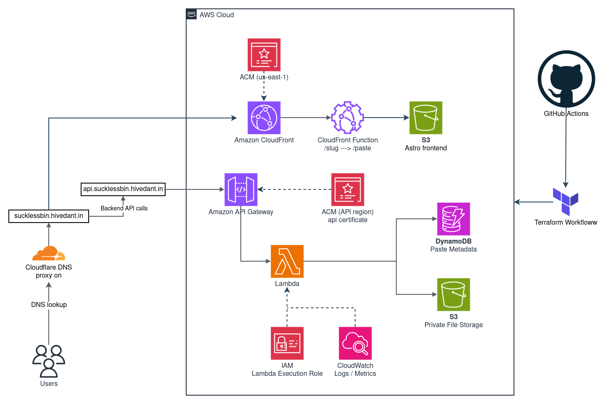
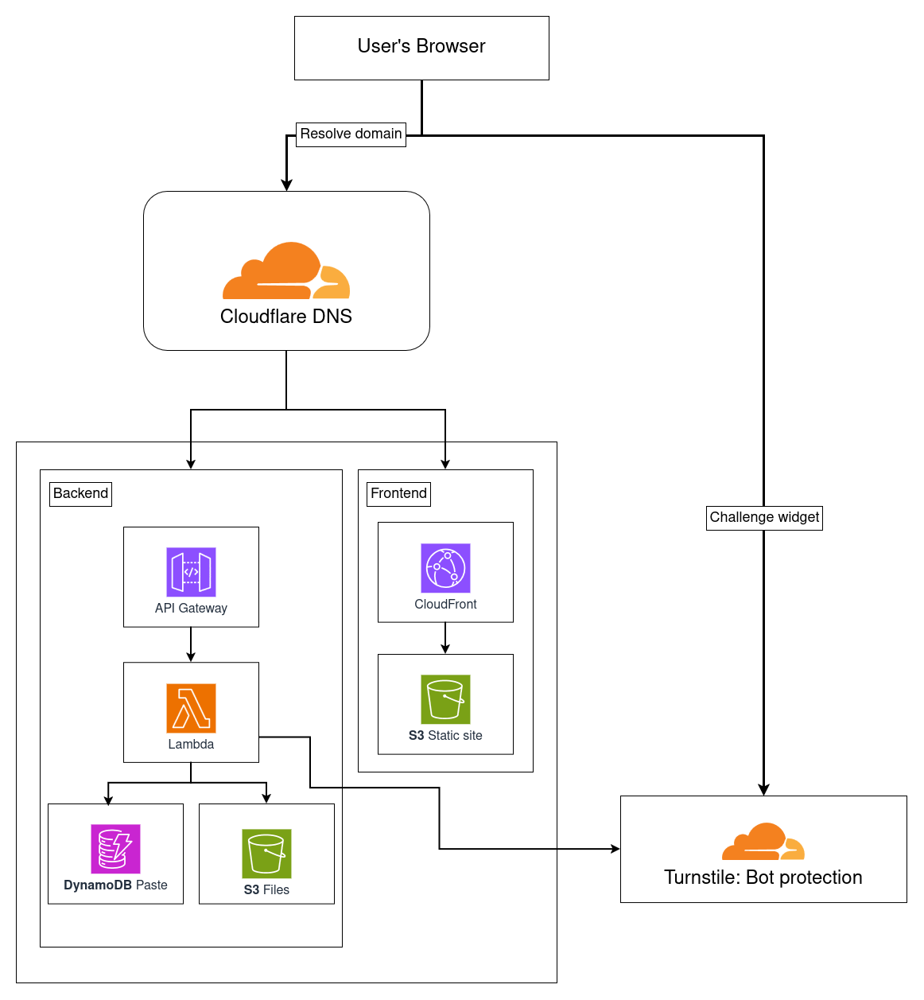
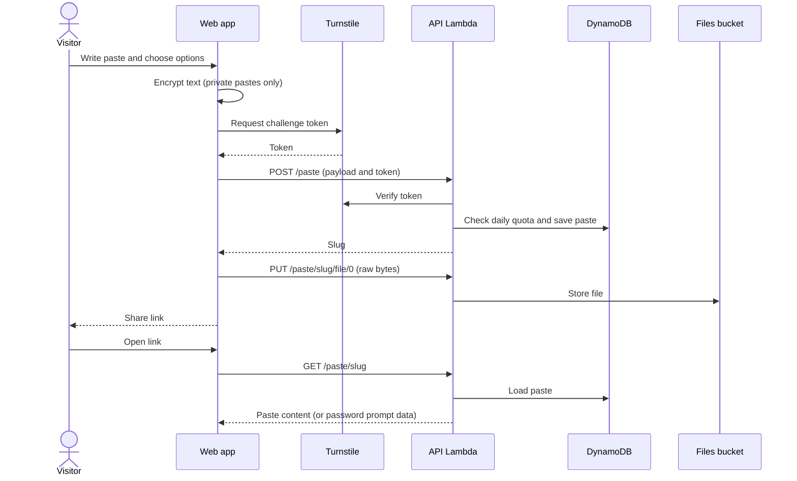
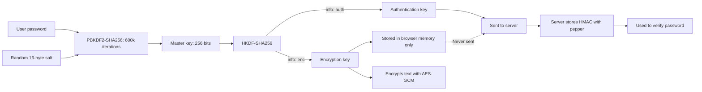

# sucklessbin

A serverless, privacy-focused text and file sharing service. Pastes expire automatically, private pastes are encrypted in the browser before they leave the device, and the entire AWS and Cloudflare stack is defined in Terraform.





## Overview

sucklessbin lets anyone share a snippet of code or text, optionally attach up to five files, and choose how long the link stays alive (20 minutes to 8 hours). Pastes can be:

- **Public**: readable by anyone with the link. The server stores the content in plaintext.
- **Private**: protected by a password. The text is encrypted in the browser with AES-GCM-256, and the server never receives the password or the decryption key.

The backend runs on AWS Lambda, API Gateway, DynamoDB, and S3, so there are no servers to patch or scale. Cloudflare provides DNS and the Turnstile bot challenge.

## Features

- End-to-end encrypted private pastes, using password-derived keys (PBKDF2 and HKDF) and AES-GCM
- Public pastes with syntax highlighting from CodeMirror 6
- Expiring links from 20 minutes to 8 hours, enforced by DynamoDB TTL and by the API itself
- Up to five file attachments per paste (4 MiB each), stored in a private S3 bucket
- Bot protection with Cloudflare Turnstile on paste creation
- Rate limits per network: a daily paste quota and a wrong-password budget per paste
- Infrastructure as code: one Terraform configuration provisions the AWS and Cloudflare resources
- Local development with a mock API that runs the real Lambda handler against in-memory storage

## How It Works

The diagrams below show the complete lifecycle of a paste, from creation to retrieval. Each component has additional detailed diagrams in its README.

### System Architecture

Requests flow through Cloudflare DNS to AWS services, with the web app and API served separately.



### Complete Paste Lifecycle

This sequence shows a paste being created with an attached file and then opened.



## Security Model

### Security Controls

| Area | Implementation |
|---|---|
| Private text encryption | The password is run through PBKDF2-SHA256 (600,000 iterations, random 16-byte salt). HKDF-SHA256 splits the result into an AES-GCM-256 key, which never leaves the browser, and an authentication key. The text is encrypted with a random 12-byte IV. |
| Password verification | The browser sends the authentication key. The server stores only `HMAC-SHA256(pepper, authKey)` and compares it in constant time. |
| Server-side pepper | A 48-character random secret generated by Terraform and stored as a Lambda environment variable. It is also mixed into the hashed network identifiers used for rate limiting. |
| Rate limiting | Five pastes per network per UTC day. Ten wrong-password attempts per paste per network per 15 minutes. Correct passwords do not use up the budget. |
| Bot protection | A Turnstile token is verified server-side before every paste is created. |
| Client IP trust | The `cf-connecting-ip` header is trusted only when the connection comes from a published Cloudflare address range. |
| Storage | Both S3 buckets block public access. Files are encrypted at rest (SSE-S3), and uploads never overwrite existing objects. |
| Transport | HTTPS is enforced at CloudFront. The files bucket denies non-TLS requests. |
| Responses | API responses send `Cache-Control: no-store` and `X-Content-Type-Options: nosniff`. |

### Encryption Key Separation

The password is split into two keys with different purposes, ensuring the server never has access to decrypt content.



The limits of this model are listed under [Known Limitations](#known-limitations).

## Technology Stack

The project uses modern serverless technologies across the stack.

| Layer | Technologies |
|---|---|
| Frontend | Astro, React islands, Tailwind CSS v4, CodeMirror 6, Base UI, TypeScript |
| API | AWS Lambda (Node.js 22, ES modules, no bundler), AWS SDK v3 |
| Data | Amazon DynamoDB (on-demand, TTL), Amazon S3 |
| Delivery | Amazon CloudFront, CloudFront Functions, API Gateway HTTP API, AWS Certificate Manager |
| Security | Cloudflare Turnstile, Web Crypto API, least-privilege IAM |
| Infrastructure | Terraform with the AWS provider 6.x and Cloudflare provider 5.x |
| Tooling | Bun (frontend), npm (Lambda tests), Node.js built-in test runner |

## Repository Layout

```
sucklessbin/
├── .github/
│   └── workflows/    GitHub Actions CI/CD pipelines
├── frontend/         Astro web application and local mock API
├── lambda/           sucklessbin API (one Lambda function) and its tests
├── terraform/        Infrastructure definition for AWS and Cloudflare
└── assets/           Images and demo media used in documentation
```

## Documentation

| Component | Covers | README |
|---|---|---|
| Frontend | Components, local development, encryption flow, deployment | [frontend/README.md](frontend/README.md) |
| API (Lambda) | Request routing, creation, unlocking, files, rate limits, client identity | [lambda/README.md](lambda/README.md) |
| Infrastructure (Terraform) | Resource layout, DNS and certificates, IAM, deployment and teardown | [terraform/README.md](terraform/README.md) |
| CI/CD (GitHub Actions) | Automated testing, deployment workflows, secrets configuration | [.github/workflows/README.md](.github/workflows/README.md) |

## Getting Started

### Run the frontend locally (no AWS account needed)

The frontend includes a mock API that runs the real Lambda handler against in-memory storage.

```bash
# 1. Install the Lambda dependencies (the mock API needs the AWS SDK)
cd lambda && npm install && cd ..

# 2. Start the mock API (port 8787)
cd frontend
bun install
bun mock/mock-server.ts

# 3. In a second terminal, start the site
bun run dev
```

For local development, set `PUBLIC_TURNSTILE_SITE_KEY` to Cloudflare's always-pass test key, `1x00000000000000000000AA`. See the [frontend README](frontend/README.md#configuration).

### Run the API tests

```bash
cd lambda
npm install
npm test
```

The tests use in-memory fakes for DynamoDB and S3 and need no AWS credentials.

### Deploy to AWS

Terraform provisions the infrastructure. The built frontend is then uploaded to S3.

```bash
cd terraform
terraform init
terraform apply          # after creating terraform.tfvars

cd ../frontend && bun install && bun run build
aws s3 sync dist/ "s3://$(terraform -chdir=../terraform output -raw frontend_bucket)" --delete
aws cloudfront create-invalidation \
  --distribution-id "$(terraform -chdir=../terraform output -raw cloudfront_distribution_id)" \
  --paths "/*"
```

The full procedure and required variables are in the [Terraform README](terraform/README.md#deployment).

## Limits

| Setting | Value |
|---|---|
| Paste expiry | 20 min, 40 min, 1 h, 2 h (default), 4 h, 8 h |
| Paste text | 200,000 characters |
| Files per paste | 5 |
| File size | 4 MiB each |
| Private password | At least 8 characters |
| Pastes per network | 5 per UTC day (configurable) |
| Wrong passwords | 10 per paste per network per 15 minutes (configurable) |
| API throttling | Burst 50, sustained 25 requests per second |
| File retention in S3 | 1 day (configurable) |

## Continuous Integration and Deployment

The project includes GitHub Actions workflows for automated testing and deployment:

- **CI Pipeline**: Runs tests, type checks, builds, and security scans on every push and PR
- **Lambda Deployment**: Manual workflow to package and deploy the API function
- **Frontend Deployment**: Manual workflow to build and deploy the static site to S3/CloudFront
- **Terraform Plan**: Automatic plan generation on infrastructure changes
- **Terraform Apply**: Manual workflow to provision or update AWS resources

See the [CI/CD documentation](.github/workflows/README.md) for setup instructions and workflow details.

## Known Limitations

- **File attachments are not end-to-end encrypted.** Private paste text is encrypted in the browser, but files are uploaded as-is. They are protected by the password check and encrypted at rest by S3, but the server can read them.
- **Titles and metadata are plaintext.** The title, language, character count, and file names of private pastes are stored unencrypted.
- **No delete or burn-after-reading endpoint.** Pastes are removed only when they expire.
- **No automated frontend tests.** The API has a test suite; the frontend does not yet.
- **API DNS record is not proxied.** The API hostname resolves directly to API Gateway, so the Cloudflare header-based client identity is inactive. See the [API README](lambda/README.md#who-is-the-visitor).
- **`UNLOCK_MAX_ATTEMPTS` is not set by Terraform.** The API uses its default of 10 unless the variable is added to the Lambda environment.
- **Changing the pepper invalidates private pastes.** Rotating `AUTH_PEPPER` makes existing private pastes impossible to unlock.
- **Default domains are project-specific.** The example domains in the Terraform variables must be replaced before deploying to another account.
