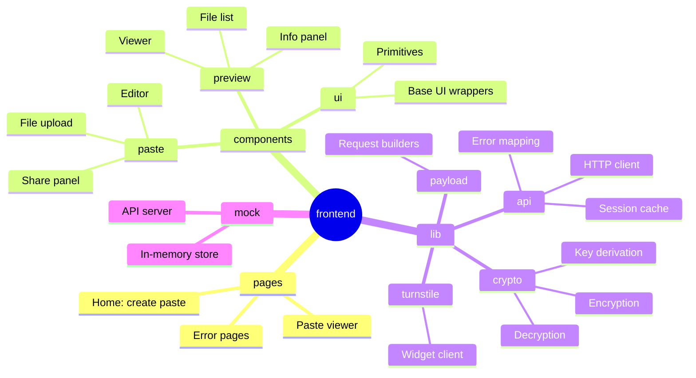
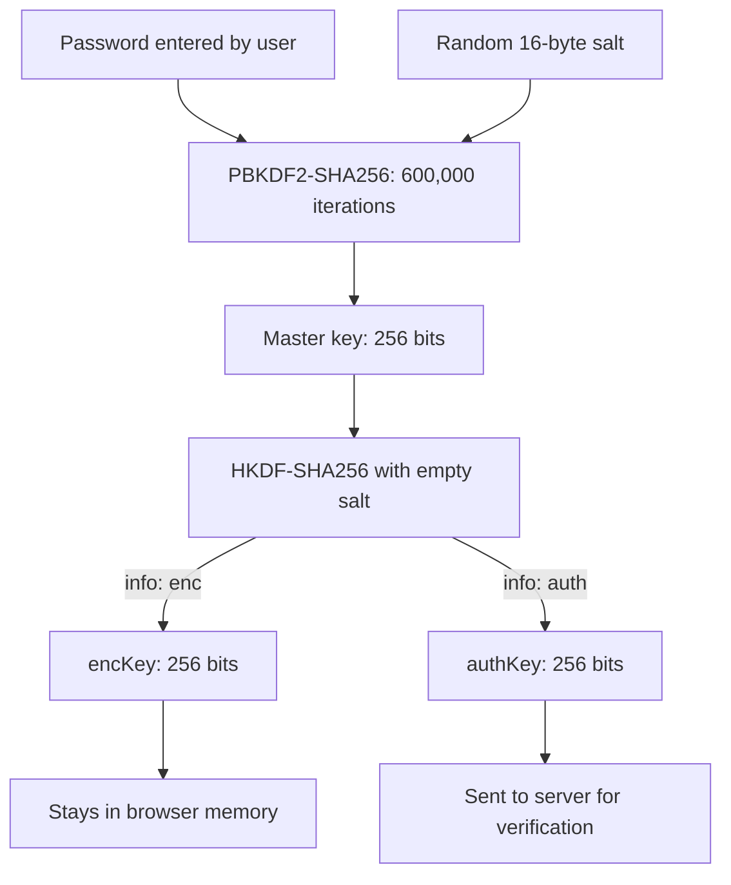
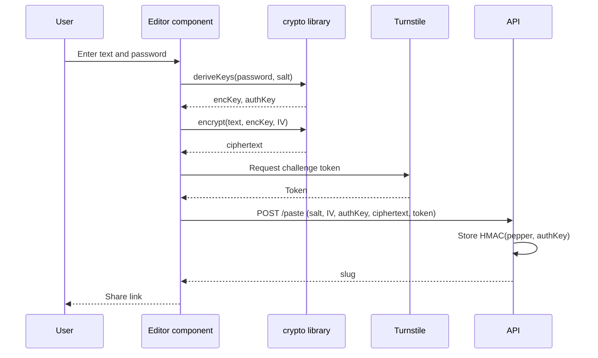
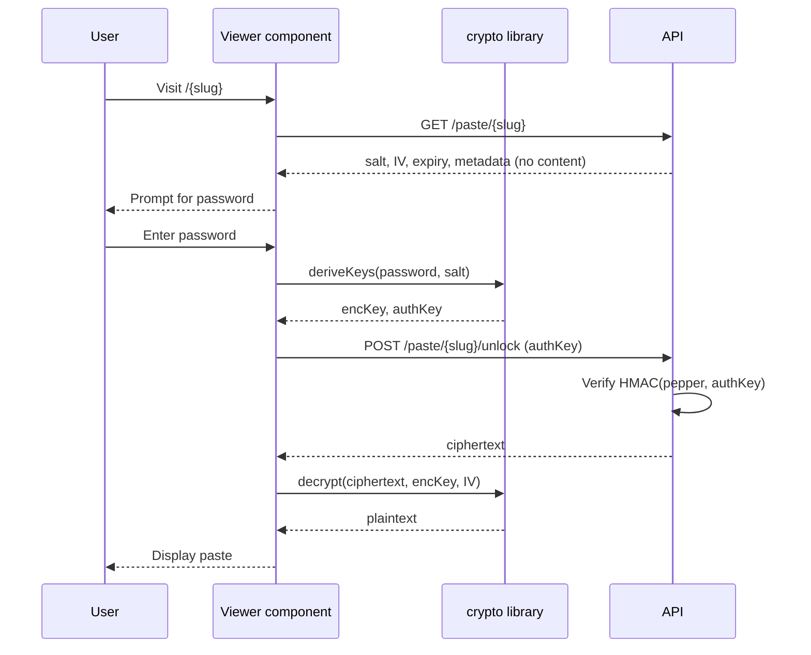
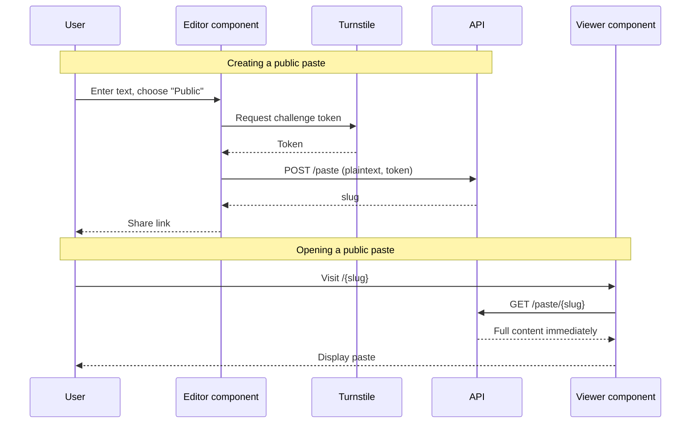

# sucklessbin Frontend

The web application for sucklessbin. It is a statically built Astro site with interactive React islands. All encryption for private pastes runs in the browser using the Web Crypto API, so the password and the decryption key never leave the device.

## Features

- Create public or password-protected pastes with an expiry from 20 minutes to 8 hours
- Syntax-highlighted editor and viewer built on CodeMirror 6, with a wide range of language packs
- Client-side encryption of private paste text (see [Encryption Design](#encryption-design))
- Up to five file attachments per paste, with previews and downloads
- Cloudflare Turnstile challenge before each paste is created
- Light and dark themes, with the Turnstile widget remounted on theme change
- A `/no-js` fallback page, since the application requires JavaScript

## Technology Stack

| Area | Technology |
|---|---|
| Framework | Astro 7 with `@astrojs/react` islands |
| Language | TypeScript |
| Styling | Tailwind CSS v4 (`@tailwindcss/vite`), `class-variance-authority`, `tailwind-merge` |
| Editor | CodeMirror 6 (`codemirror`, `@codemirror/*` language packs, One Dark theme) |
| UI primitives | Base UI (`@base-ui/react`), `lucide-react` icons, `sonner` notifications |
| Typography | IBM Plex Mono via Astro fonts (fontsource) |
| Package manager | Bun (`bun.lock` is committed) |

## Prerequisites

- [Bun](https://bun.sh) (used for installs, scripts, and the mock server)
- Node.js 22.12.0 or later (declared in `engines`)
- For local API development: the Lambda dependencies (`cd ../lambda && npm install`)

## Configuration

Set these in a `.env` file in this directory (Astro loads it automatically) or in the build environment.

| Variable | Required | Default | Purpose |
|---|---|---|---|
| `PUBLIC_API_URL` | No | `/api` | Base URL of the API. Trailing slashes are removed. |
| `PUBLIC_TURNSTILE_SITE_KEY` | Yes | None | Turnstile site key. Without it, the widget shows an explicit configuration error. |

For local development, use Cloudflare's published test key, which always passes the challenge:

```bash
PUBLIC_TURNSTILE_SITE_KEY=1x00000000000000000000AA
```

The matching test secret, `1x0000000000000000000000000000000AA`, is the secret that the mock API accepts. The mock does not verify tokens against Cloudflare; it accepts any token except the literal string `fail`.

## Local Development

The frontend can be developed without deploying anything. A mock API runs the real Lambda handler (`lambda/src`) on port 8787 against in-memory DynamoDB and S3 fakes.

```bash
# 1. Install the Lambda dependencies. The mock imports the handler, which needs the AWS SDK.
cd ../lambda && npm install && cd ../frontend

# 2. Install frontend dependencies
bun install

# 3. Start the mock API (terminal 1)
bun mock/mock-server.ts

# 4. Start the Astro dev server (terminal 2)
bun run dev
```

During development, Astro proxies `/api/*` to `http://localhost:8787` and strips the `/api` prefix. The dev server also rewrites `/<slug>` to the viewer page, matching the production routing described below.

The mock is configured for fast iteration:

| Variable | Default | Effect |
|---|---|---|
| `DAILY_PASTE_LIMIT` | `2` | Pastes allowed per network per day |
| `UNLOCK_MAX_ATTEMPTS` | `5` | Wrong-password attempts allowed per window |
| `MOCK_DELAY` | `1` | Multiplier for simulated network and storage latency |

Run the mock with these variables set in the environment, for example `DAILY_PASTE_LIMIT=5 bun mock/mock-server.ts`.

The mock is a development tool only. It is not part of the production build and is not started by a `package.json` script.

## Scripts

| Command | Description |
|---|---|
| `bun run dev` | Start the Astro development server |
| `bun run build` | Produce the static site in `dist/` |
| `bun run preview` | Serve the production build locally |
| `bun run astro check` | Run Astro's type and template checks |

The project does not currently include automated tests.

## Build and Deployment

The site is static, so deployment means uploading `dist/` to the S3 bucket that Terraform created and invalidating the CloudFront cache.

```bash
bun run build

BUCKET="$(terraform -chdir=../terraform output -raw frontend_bucket)"
DIST_ID="$(terraform -chdir=../terraform output -raw cloudfront_distribution_id)"

aws s3 sync dist/ "s3://${BUCKET}" --delete
aws cloudfront create-invalidation --distribution-id "${DIST_ID}" --paths "/*"
```

Set `PUBLIC_TURNSTILE_SITE_KEY` to the production site key before running `bun run build`, since Astro inlines public variables at build time. Frontend deployment is not part of `terraform apply`.

## Project Structure

The source directory is organized around the React component tree and supporting libraries:



```
frontend/
├── astro.config.mjs        Build, dev proxy, and routing configuration
├── mock/mock-server.ts     Local API server that runs the real Lambda handler
├── public/                 Static assets copied as-is (favicon)
└── src/
    ├── assets/             Images used by pages (404, 410, no-JS illustrations)
    ├── components/
    │   ├── paste/          Editor, share panel, and file upload components
    │   ├── preview/        Paste viewer, info panel, and file list
    │   ├── dashboard/      Dashboard paste cards
    │   ├── navigation/     Site navigation
    │   ├── hooks/          Shared React hooks
    │   └── ui/             Reusable UI primitives
    ├── layouts/            Base page layout
    ├── lib/
    │   ├── api/            HTTP client, error mapping, and paste caching
    │   ├── crypto/         Key derivation, encryption, and decryption
    │   ├── payload/        Builds public and private paste requests
    │   └── turnstile/      Turnstile widget client
    ├── pages/              Routes (see the table below)
    └── styles/             Global styles and theme tokens
```

## Routes

| Path | Purpose |
|---|---|
| `/` | Create a paste |
| `/paste` | View a paste. Reached by visiting `/<slug>`, which the site router rewrites. |
| `/no-js` | Shown to visitors with JavaScript disabled |
| `/404` | Shown for unknown paths |
| `/410` | "Paste burned" page, used when the client receives a 410 Gone response. The current API returns 404 for missing or expired pastes. |

In production, CloudFront uses the `site-router` function (in `terraform/functions/`) to perform the same rewrite, along with directory index handling.

## Encryption Design

Private pastes are protected entirely in the browser. The server receives only what it needs to verify the password, plus ciphertext.

### Key Derivation

The password is transformed into two separate keys: one for encryption (which never leaves the browser) and one for authentication (sent to the server).



### Private Paste Creation Flow

When creating a private paste, encryption happens before the API request is made.



### Private Paste Unlock Flow

Opening a private paste requires fetching metadata first, then deriving the authentication key to prove knowledge of the password.



### Public Paste Flow

Public pastes skip encryption entirely. The content is sent and received as plaintext.



### Cryptographic Parameters

| Step | Detail |
|---|---|
| Master key | PBKDF2-SHA256, 600,000 iterations, 16-byte random salt, 256-bit output |
| Subkeys | HKDF-SHA256 with an empty salt. Info `"enc"` gives the AES key; info `"auth"` gives the 256-bit authentication key. |
| Text encryption | AES-GCM-256 with a random 12-byte IV |
| Server contract | The server never receives the password or `encKey`. It stores only `HMAC-SHA256(pepper, authKey)`. |
| Key lifetime | Keys are held in memory for the tab's session. The authentication key is kept in an in-memory map keyed by slug in `lib/api/paste/session.ts`. |

File attachments are uploaded as raw bytes for both public and private pastes. They are not encrypted in the browser. See the root README's [Known Limitations](../README.md#known-limitations).

## Implementation Notes

- **Upload progress is simulated.** The progress bar in `components/paste/upload/Upload.tsx` uses timers and does not reflect real transfer progress. The actual uploads happen when the paste is submitted, in `components/paste/share/generate.ts`.
- **Limits are duplicated on the server.** The five-file limit, 4 MiB file size, and expiry options match the values in `lambda/src/config.mjs`. Change both if you change either.
- **Turnstile action binding.** The client sends the action `create-paste`. The API checks this value, so the two must stay in sync.
- **Session key cleanup.** `clearAuthKey` in `lib/api/paste/session.ts` is currently unused. It is available if keys should be cleared explicitly.
- **Local dev tunnels.** `astro.config.mjs` allows `*.trycloudflare.com` hosts so the dev server can be tested through a tunnel. Remove that entry if it is not needed.
