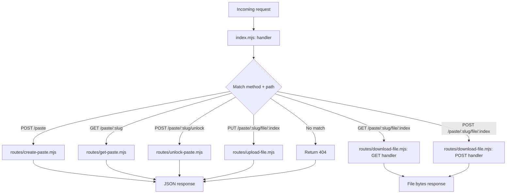
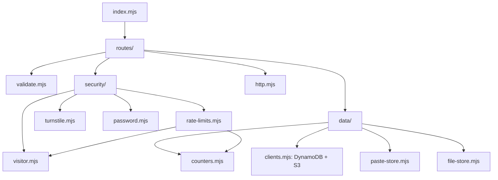
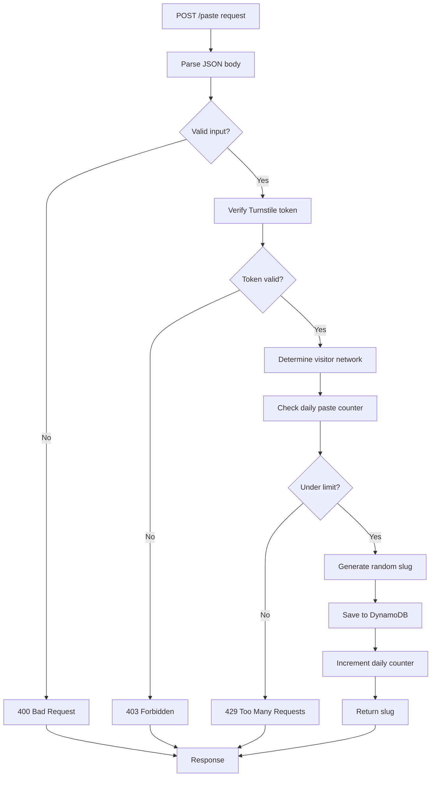
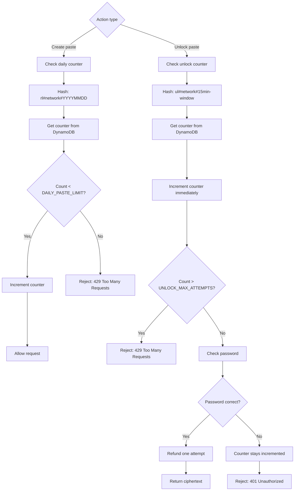
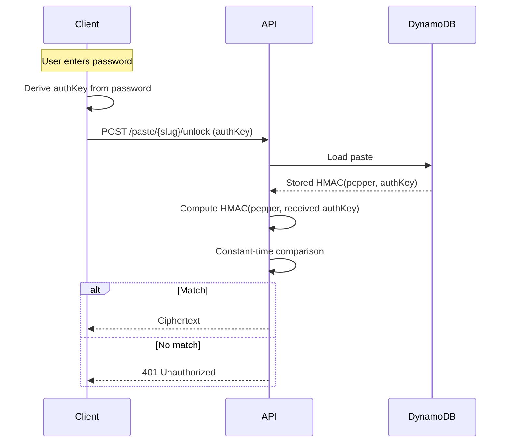
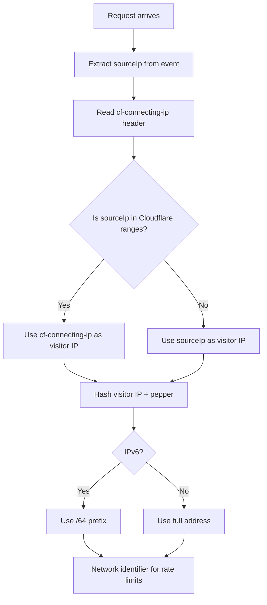
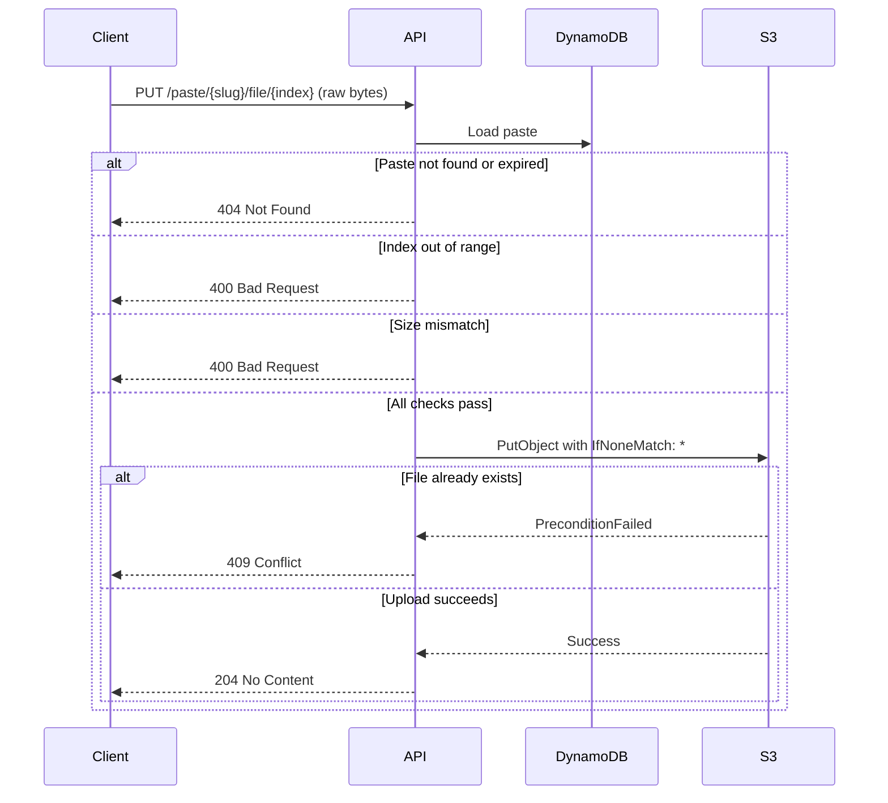
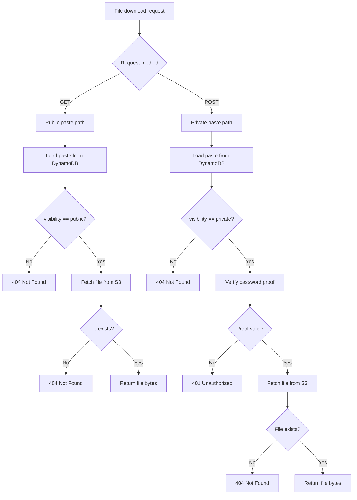
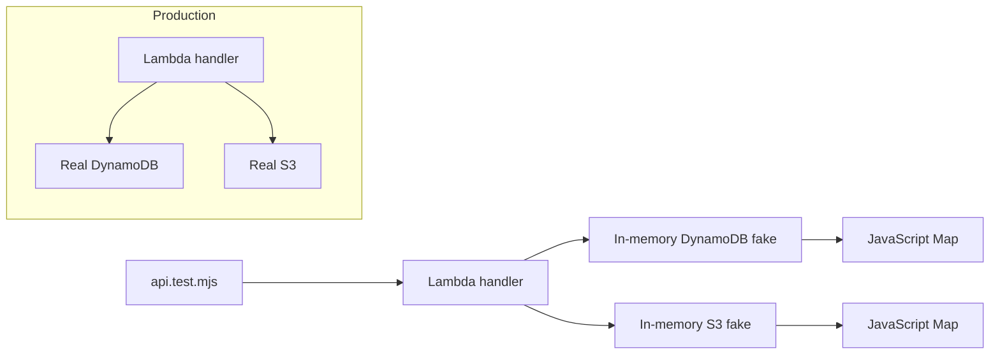

# sucklessbin API (Lambda)

A single AWS Lambda function serves every API endpoint. API Gateway passes each request to the function, which responds with JSON or raw file bytes. The deployed function has no dependencies: the Node.js 22 runtime already includes the AWS SDK.

## Request Flow

```
browser -> API Gateway -> index.mjs -> one file in routes/ -> DynamoDB / S3
```

1. `index.mjs` matches `"METHOD /path"` against the route table and calls the route function.
2. The route function runs its steps in order. Each file begins with a comment listing those steps.
3. Errors thrown as `HttpError(status, message)` become JSON responses (`{ "error": "..." }`). Any other error is logged and returned as a generic 500. Request bodies are never logged.

### Request Routing

Every request enters through `index.mjs`, which matches the method and path against a route table.



## Endpoints

The API exposes six routes, all handled by a single Lambda function.

| Request | File | Purpose |
|---|---|---|
| `POST /paste` | `routes/create-paste.mjs` | Validate input, verify Turnstile, enforce the daily limit, save the paste |
| `GET /paste/{slug}` | `routes/get-paste.mjs` | Public pastes: full content. Private pastes: only the details needed to request a password |
| `POST /paste/{slug}/unlock` | `routes/unlock-paste.mjs` | Verify the password proof and return the encrypted text |
| `PUT /paste/{slug}/file/{index}` | `routes/upload-file.mjs` | Store one file. Each index can be written once, and the size must match the declared size exactly |
| `GET /paste/{slug}/file/{index}` | `routes/download-file.mjs` | Download a file from a public paste |
| `POST /paste/{slug}/file/{index}` | `routes/download-file.mjs` | Download a file from a private paste. Requires the password proof in the body. |

## Source Layout

```
src/
  index.mjs            Entry point: route table and error handling
  config.mjs           All settings: environment variables and limits
  http.mjs             HttpError, json(), bytes(), readJson(), readBytes()
  validate.mjs         Validation of browser input and slugs
  slug.mjs             Generates paste identifiers (10 random letters)
  routes/              One file per endpoint, plus load-paste.mjs (shared by routes that open a paste)
  security/
    turnstile.mjs      Verifies the Turnstile token with Cloudflare
    password.mjs       Checks a private paste's password proof
    rate-limits.mjs    Daily creation limit and password attempt limit
    visitor.mjs        Determines the visitor's address and network
  data/
    clients.mjs        DynamoDB and S3 clients
    paste-store.mjs    Saves and loads pastes
    counters.mjs       Counters behind the rate limits
    file-store.mjs     Saves and loads files
test/api.test.mjs      Test suite (in-memory fakes, no AWS access required)
```

### Module Dependencies

The route handlers depend on shared validation, security, and data modules.



## Configuration

Environment variables are set by Terraform in the function's `environment` block.

| Variable | Required | Default | Purpose |
|---|---|---|---|
| `TABLE_NAME` | Yes | None | DynamoDB table for pastes and rate-limit counters |
| `FILES_BUCKET` | Yes | None | Private S3 bucket for uploaded files |
| `AUTH_PEPPER` | Yes | None | Secret mixed into stored hashes (passwords and network identifiers) |
| `TURNSTILE_SECRET_KEY` | Yes | None | Cloudflare Turnstile secret key |
| `DAILY_PASTE_LIMIT` | No | `5` | Pastes allowed per network per UTC day. Set by Terraform. |
| `UNLOCK_MAX_ATTEMPTS` | No | `10` | Wrong-password attempts allowed per paste, per network, per 15 minutes. Not set by Terraform, so the default applies. |

Required variables are read when first needed. A missing variable fails the affected request with a clear error instead of stopping the function from starting.

Fixed limits are in `src/config.mjs`:

| Limit | Value |
|---|---|
| Maximum request body | 360,000 bytes |
| Files per paste | 5 |
| Maximum file size | 4 MiB (4,194,304 bytes) |
| Expiry options | 20m, 40m, 1h, 2h, 4h, 8h |
| Expiry grace period (reads) | 3,600 seconds |

The file size limit comes from Lambda's 6 MB request payload limit. Base64 encoding adds about one third, so a 4 MiB file becomes roughly 5.6 MB on the wire. If you change a file limit, change the matching value in the frontend.

## Paste Creation Flow

The `POST /paste` endpoint validates input, checks the Turnstile token, enforces the daily paste limit, and saves the paste.



Steps are ordered by cost: cheap validations run before the Turnstile HTTP call, which runs before the DynamoDB write.

## Rules

- **Pastes expire** after 20 minutes to 8 hours. DynamoDB removes expired items on its own schedule, which can take up to 48 hours, so every read also checks the expiry time.
- **5 pastes per day per network** (configurable), resetting at 00:00 UTC. IPv6 addresses are counted by their /64 prefix.
- **10 wrong passwords per paste, per network, per 15 minutes** (configurable). Only the offending network is paused. Other visitors can still unlock the paste. A correct password does not count against the budget.
- **Private paste contents are encrypted in the browser.** The server stores ciphertext and `HMAC-SHA256(pepper, authKey)`, never the password.
- **Files are write-once.** Uploads use a conditional write, so an existing file cannot be overwritten.

### Rate Limiting Logic

Two separate counters enforce the daily paste limit and the wrong-password limit.



### Password Verification Flow

The server never sees the password or the encryption key. It stores and checks a keyed hash of the authentication key.



## Who Is the Visitor?

Rate limits depend on the visitor's network address. `security/visitor.mjs` determines it as follows:

- If the request came directly from a visitor, the address is the visitor's own address.
- If the API hostname is proxied through Cloudflare, the connection comes from a Cloudflare server. In that case `visitor.mjs` reads the real address from the `cf-connecting-ip` header, but **only when the connection comes from one of Cloudflare's published IP ranges**. A client that bypasses Cloudflare and calls API Gateway directly is counted by its own address, so forging the header has no effect.

**Current deployment:** `terraform/10-API-cloudflare.tf` creates the API DNS record with `proxied = false`. Visitors therefore connect to API Gateway directly, and the proxy path is inactive. Enabling the proxy requires changing that record to `proxied = true`, which also places Cloudflare's network in front of the API. Cloudflare's ranges are listed at https://www.cloudflare.com/ips and are hardcoded in `visitor.mjs`. Review them periodically.

### Visitor IP Determination

The API uses the connection's source IP unless it came from Cloudflare, in which case it trusts the forwarded header.



### File Upload Flow

Files are uploaded one at a time after the paste is created. Each file index can be written once.



### File Download Flow

Public paste files are downloaded with GET. Private paste files require a POST with the password proof.



## Tests

```bash
npm install     # needed only for the tests; the deployed function has no dependencies
npm test
```

The suite requires Node.js 22 or later. It runs against in-memory fakes for DynamoDB and S3 and needs no AWS credentials. The mock API for the frontend (`frontend/mock/mock-server.ts`) imports this same code, so changes here are reflected in local development.

### Test Architecture

The test suite uses in-memory fakes that implement the same interface as the AWS SDK clients.


