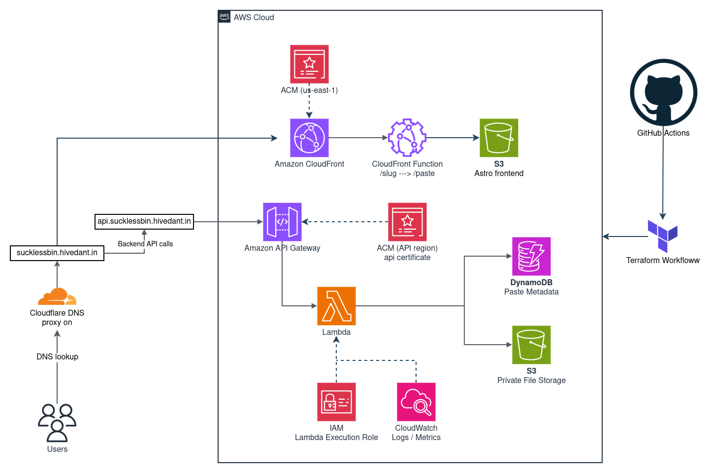
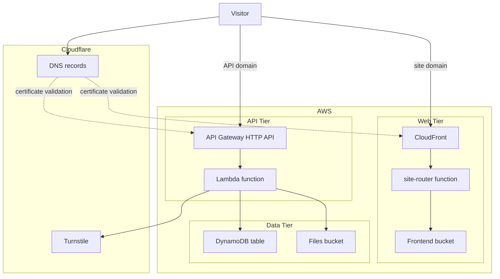
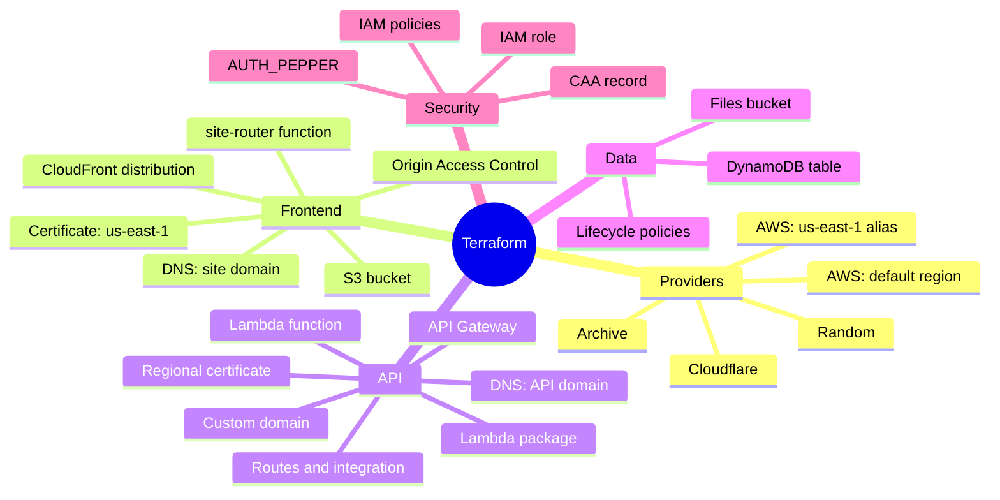
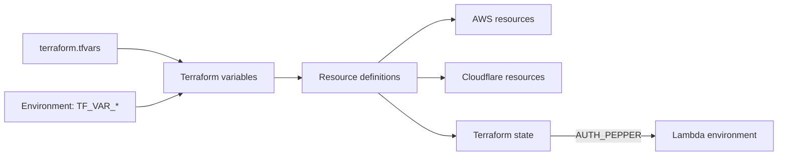
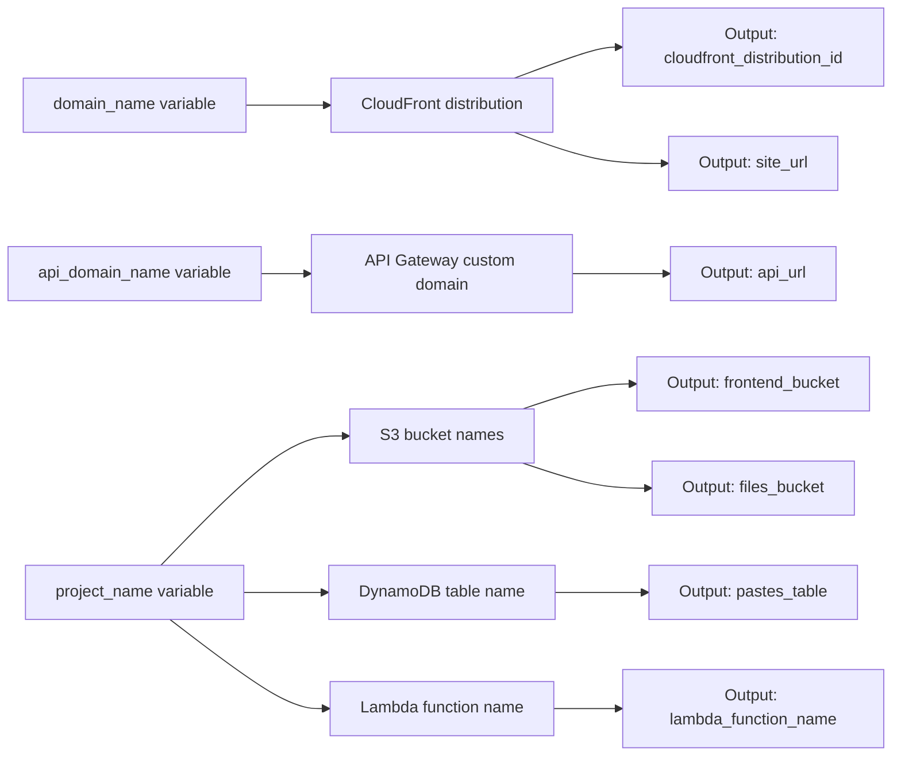
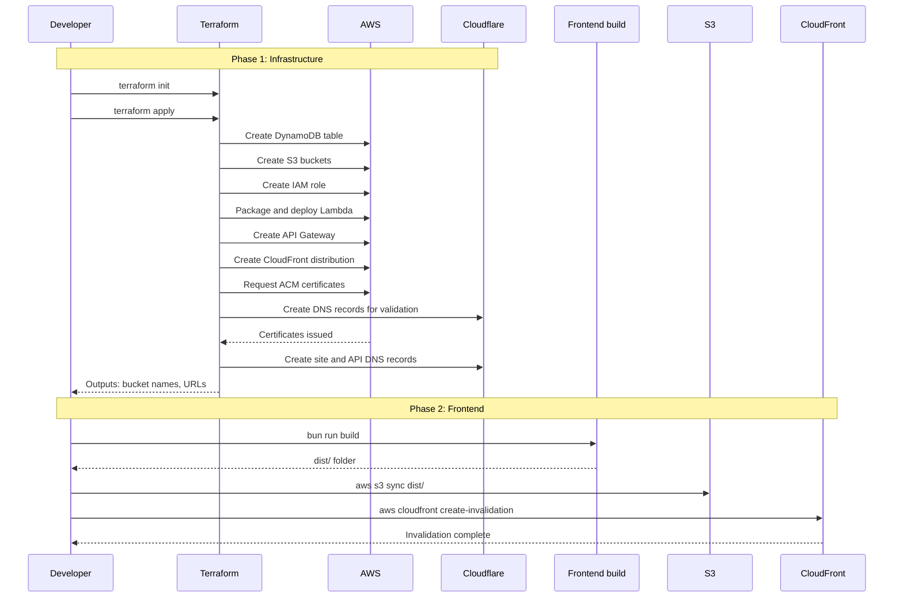
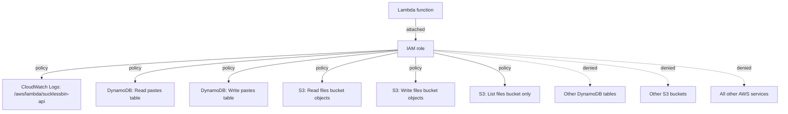
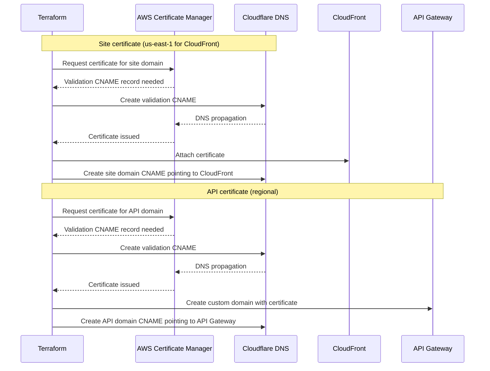

# sucklessbin Infrastructure (Terraform)

This directory defines the complete sucklessbin deployment: the AWS resources that host the frontend and run the API, and the Cloudflare DNS records and certificate validation that expose them under custom domains. A single `terraform apply` creates everything except the frontend build artifacts, which are uploaded separately.

## Architecture



### High-Level Overview



### Resource Dependencies

Terraform creates resources in dependency order. The diagram shows which resources must exist before others can be created.

```mermaid
flowchart TD
    PEPPER[random_password: AUTH_PEPPER] --> LAMBDA
    ROLE[IAM role] --> LAMBDA
    TABLE[DynamoDB table] --> ROLE_POLICY[IAM policy attachment]
    FILES[Files bucket] --> ROLE_POLICY
    ROLE_POLICY --> ROLE
    LAMBDA_ZIP[Archive: Lambda package] --> LAMBDA[Lambda function]
    
    LAMBDA --> APIGW_INT[API Gateway integration]
    APIGW[API Gateway HTTP API] --> APIGW_INT
    APIGW --> APIGW_STAGE[API Gateway stage]
    
    APIGW_STAGE --> API_CERT[Regional certificate for API]
    API_CERT --> API_DOMAIN[API Gateway custom domain]
    API_DOMAIN --> API_MAPPING[API Gateway domain mapping]
    API_CERT --> API_DNS[Cloudflare DNS: api subdomain]
    
    FRONTEND[Frontend bucket] --> OAC[CloudFront Origin Access Control]
    OAC --> CF[CloudFront distribution]
    ROUTER[CloudFront Function: site-router] --> CF
    CF --> FRONTEND_POLICY[Frontend bucket policy]
    
    CF --> SITE_CERT[Certificate for site: us-east-1]
    SITE_CERT --> SITE_DNS[Cloudflare DNS: site subdomain]
```



## Resources by File

The Terraform configuration is split into logical files, each managing a slice of the infrastructure.

| File | Resources |
|---|---|
| `0-providers.tf` | Provider configuration: AWS (default region plus a `us-east-1` alias for CloudFront certificates), Cloudflare, Random, Archive. Optional remote state backend. |
| `1-variables.tf` | Input variables and common tags |
| `1-output.tf` | Output values used by the deployment steps |
| `2-S3.tf` | Frontend bucket: public access blocked, versioning enabled, policy that allows only the CloudFront distribution to read |
| `3-CloudFront.tf` | Origin Access Control, CloudFront distribution (HTTPS only, TLS 1.2 minimum, error pages mapped to `404.html`), `site-router` CloudFront Function |
| `4-ACM-Cloudflare.tf` | Site certificate (us-east-1) with DNS validation in Cloudflare, `CNAME` for the site domain, CAA record for `root_domain` |
| `5-DynamoDB.tf` | `<project_name>-pastes` table: on-demand billing, partition key `slug`, TTL on `ttl` |
| `6-S3-files.tf` | Files bucket: public access blocked, bucket owner enforced, SSE-S3 encryption, lifecycle expiry, deny-non-TLS policy |
| `7-IAM.tf` | Lambda execution role: basic logging, DynamoDB read and write on the pastes table only, S3 object read and write on the files bucket only |
| `8-lambda.tf` | Packaging of `../lambda/src`, the pepper, log group, and the `<project_name>-api` function (Node.js 22, arm64, 10-second timeout) |
| `9-API-gateway.tf` | HTTP API, CORS for the site origin, Lambda proxy integration, six routes, default stage with throttling |
| `10-API-cloudflare.tf` | Regional certificate for the API domain, API Gateway custom domain and mapping, `CNAME` for the API domain |
| `functions/site-router.js` | CloudFront Function that rewrites `/<slug>` to the viewer page and appends `index.html` to directory and extensionless paths |

Two generated items are not committed: `.build/` holds the Lambda zip created during planning, and the pepper is stored in state.

### Resource Organization

Each file groups related resources by their purpose in the system.



## Prerequisites

- A current Terraform CLI release
- AWS credentials with permission to create the resources above (for example, through `AWS_PROFILE`)
- A Cloudflare API token with **Zone:DNS:Edit** permission on the zone that hosts your domain
- The Cloudflare zone ID for that domain
- A Cloudflare Turnstile site and its secret key
- Two subdomains of that zone for the site and the API

## Configuration

Create `terraform.tfvars` in this directory. The file is git-ignored. Replace every placeholder with your values:

```hcl
cloudflare_api_token = "your-cloudflare-api-token"
cloudflare_zone_id   = "your-zone-id"
turnstile_secret_key = "your-turnstile-secret-key"

root_domain     = "example.com"
domain_name     = "sucklessbin.example.com"
api_domain_name = "api.sucklessbin.example.com"
```

To keep secrets out of files on disk, pass them as environment variables instead:

```bash
export TF_VAR_cloudflare_api_token="..."
export TF_VAR_turnstile_secret_key="..."
```

### Configuration Flow

Variables flow from `terraform.tfvars` or environment variables into resources.



### Variables

| Variable | Default | Required | Description |
|---|---|---|---|
| `cloudflare_api_token` | None | Yes | Cloudflare API token with DNS edit permission |
| `cloudflare_zone_id` | None | Yes | Cloudflare zone ID |
| `turnstile_secret_key` | None | Yes | Turnstile secret key (marked sensitive) |
| `project_name` | `suckless-bin` | No | Prefix for resource names |
| `aws_region` | `us-east-1` | No | Region for the regional resources |
| `root_domain` | `hivedant.in` | No | Zone apex used for the CAA record |
| `domain_name` | `sucklessbin.hivedant.in` | No | Domain for the site |
| `api_domain_name` | `api.sucklessbin.hivedant.in` | No | Domain for the API |
| `environment` | `dev` | No | Value of the `Environment` tag |
| `tags` | `{}` | No | Additional tags applied to resources |
| `price_class` | `PriceClass_100` | No | CloudFront price class |
| `files_retention_days` | `1` | No | Days before uploaded files are deleted |
| `lambda_memory_mb` | `128` | No | Lambda memory size |
| `log_retention_days` | `14` | No | CloudWatch log retention |
| `daily_paste_limit` | `5` | No | Pastes per network per day (passed to the API) |
| `api_routes` | Six routes | No | Route keys for API Gateway |

The defaults for `project_name`, `root_domain`, `domain_name`, and `api_domain_name` are from the original deployment. Override them for your own domains.

### Outputs

Terraform outputs provide the information needed to deploy the frontend and verify the deployment.

| Output | Description |
|---|---|
| `site_url` | Public URL of the site |
| `api_url` | Public URL of the API |
| `frontend_bucket` | S3 bucket that receives the built frontend |
| `cloudfront_distribution_id` | Distribution to invalidate after a frontend upload |
| `files_bucket` | S3 bucket that stores uploaded files |
| `lambda_function_name` | Name of the API function |
| `pastes_table` | DynamoDB table name |

### Variable and Output Flow

Inputs are transformed into resource attributes, which are then exposed as outputs for use in deployment scripts.



## Deployment

```bash
cd terraform
terraform init
terraform plan
terraform apply
```

The first apply can take several minutes. CloudFront distributions and API Gateway custom domains take longer to deploy than other resources.

After the infrastructure exists, deploy the frontend:

```bash
cd ../frontend
bun install
bun run build

aws s3 sync dist/ "s3://$(terraform -chdir=../terraform output -raw frontend_bucket)" --delete
aws cloudfront create-invalidation \
  --distribution-id "$(terraform -chdir=../terraform output -raw cloudfront_distribution_id)" \
  --paths "/*"
```

Use `terraform output site_url` and `terraform output api_url` to find the live addresses. Until the frontend is uploaded, the site URL returns an error.

Frontend deployment is intentionally outside Terraform. Keeping it separate means a UI change does not require an infrastructure plan, and the upload can be scripted or moved into a CI pipeline later.

### Deployment Sequence

The deployment process has two distinct phases: infrastructure provisioning and frontend upload.



## Security Notes

- **State contains secrets.** The Terraform state records the generated `AUTH_PEPPER` and the Turnstile secret. Use the remote S3 backend that is commented out in `0-providers.tf`, which encrypts state and uses `use_lockfile` for locking, rather than local state. Replace the example bucket name with your own, and restrict access to it.
- **Local secret files are git-ignored.** `*.tfstate`, `*.tfvars`, and `.env` are excluded by `.gitignore`. Do not commit them.
- **Pepper rotation has consequences.** The pepper is a `random_password` resource. Replacing it (for example, with `terraform apply -replace`) invalidates the password proof of every existing private paste, and those pastes can no longer be unlocked. Public pastes are not affected.
- **Buckets are private.** Both S3 buckets block public access. Files are encrypted at rest with SSE-S3, and the files bucket denies any request that is not made over TLS.
- **Least-privilege IAM.** The Lambda role can read and write items in the one pastes table, read and write objects in the files bucket, and list only the files bucket. It has no other AWS permissions beyond basic CloudWatch logging.

### IAM Permission Scope

The Lambda execution role follows least-privilege: it can only access the specific resources it needs.



### Certificate and DNS Flow

ACM certificates require DNS validation through Cloudflare before they can be used.



## Known Issues and Decisions

- **API record is not proxied.** `10-API-cloudflare.tf` sets `proxied = false`, so the API is reached directly. The API's client-IP logic is designed for a proxied record. See the [API README](../lambda/README.md#who-is-the-visitor).
- **`UNLOCK_MAX_ATTEMPTS` is not configured.** The Lambda environment block sets `DAILY_PASTE_LIMIT` only, so the API uses its built-in default of 10. Add the variable to `8-lambda.tf` and expose it as a Terraform variable if you want to change it.
- **CAA record may conflict.** `4-ACM-Cloudflare.tf` creates a CAA record that allows Amazon to issue certificates for `root_domain`. If the zone already has CAA records, Cloudflare may reject the new record or it may need to be merged with the existing set.
- **Frontend build is not run by Terraform.** The `.build/` folder contains only the Lambda package.
- **Default names are project-specific.** Replace the default domains and, if desired, `project_name` before deploying to a different account.

## Teardown

```bash
aws s3 rm "s3://$(terraform output -raw frontend_bucket)" --recursive
aws s3 rm "s3://$(terraform output -raw files_bucket)" --recursive
terraform destroy
```

Terraform cannot delete a bucket that still contains objects. The frontend bucket has versioning enabled, so `aws s3 rm` only adds delete markers; old object versions remain and must be removed with a version-aware method (the S3 console, or `aws s3api delete-objects` with the listed version IDs) before `terraform destroy` can delete the bucket.
